# Histopathology LIMS

**Phase 2 / 3 — a connected, offline-capable histopathology LIMS.** A block-and-slide level laboratory information management system for hospital histopathology departments, designed Nigeria-first for low-resource, low-bandwidth laboratories.

Phase 1 built the custody, worklist and synoptic reporting core. Phase 2 adds the referral portal, real notification delivery, reagent/antibody lot control and QA peer review. Phase 3 adds the offline-first scan queue, FHIR R4, HL7 v2, whole-slide imaging, SNOMED CT / ICD-O-3 coding, Paystack/Flutterwave payments and HMO claims export.

Most LIMS stop at the specimen. This one follows the physical work: a specimen becomes cassettes, cassettes become slides, and every movement is an immutable custody event. Status is never typed in — it is derived by a state machine from the last scan. Pathologists get a prioritised worklist, structured synoptic reporting, server-rendered PDFs with verification QR codes, and reports that lock on sign-out.

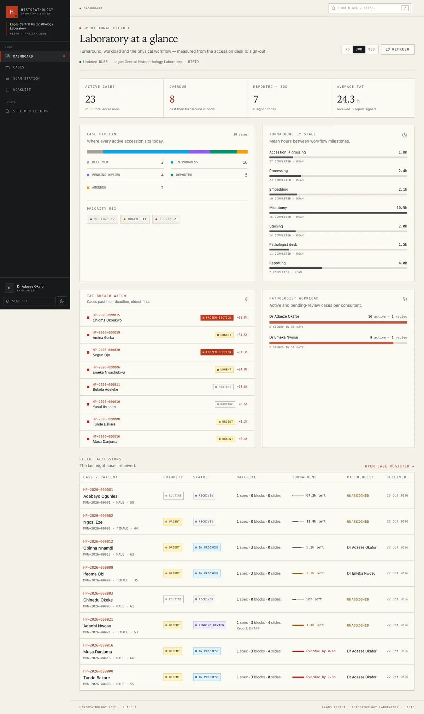

| Worklist                                                 | Case file                                                          |
| -------------------------------------------------------- | ------------------------------------------------------------------ |
| 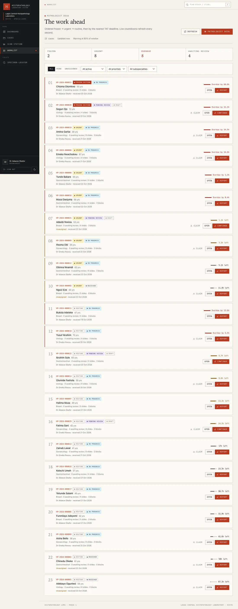      | 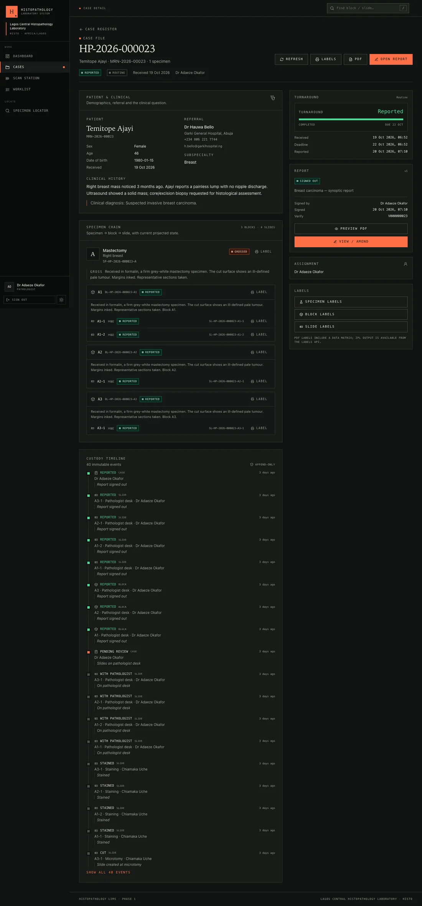 |
| **Scan station**                                         | **Synoptic report**                                                |
| 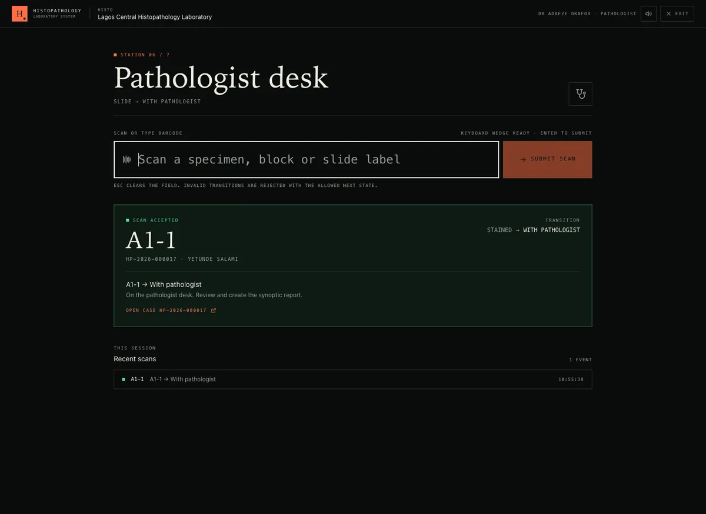 | 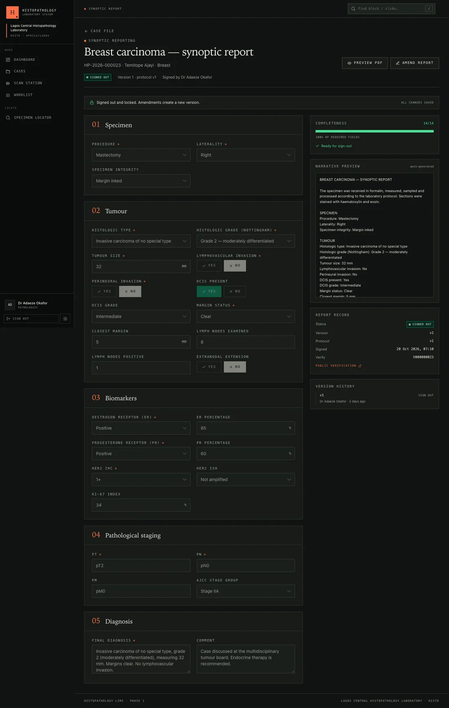         |
| **Referral portal**                                      | **Referral detail**                                                |
| 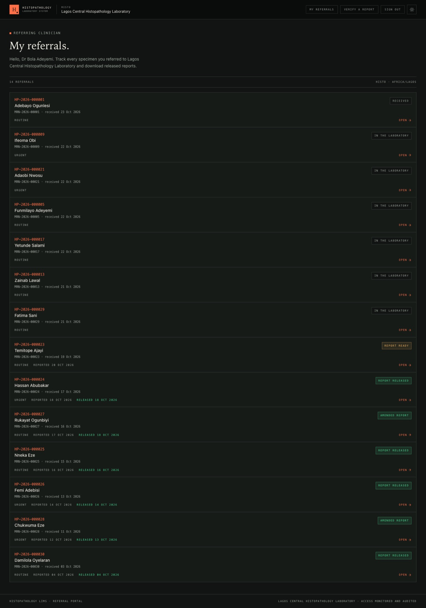     | 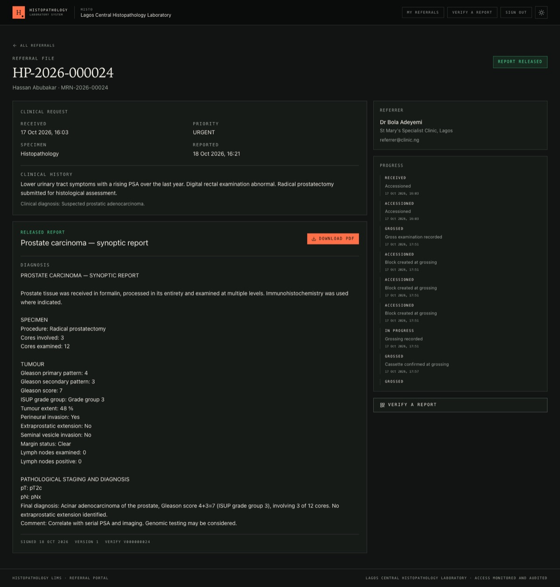               |
| **Reagent & antibody inventory**                         | **QA peer review**                                                 |
| 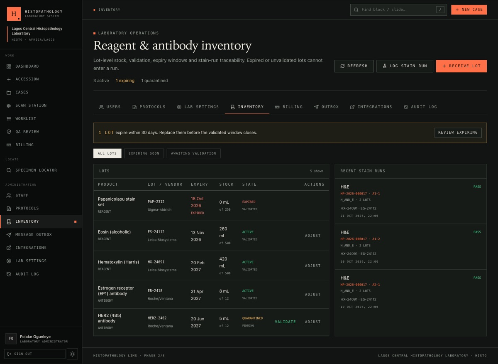                 | 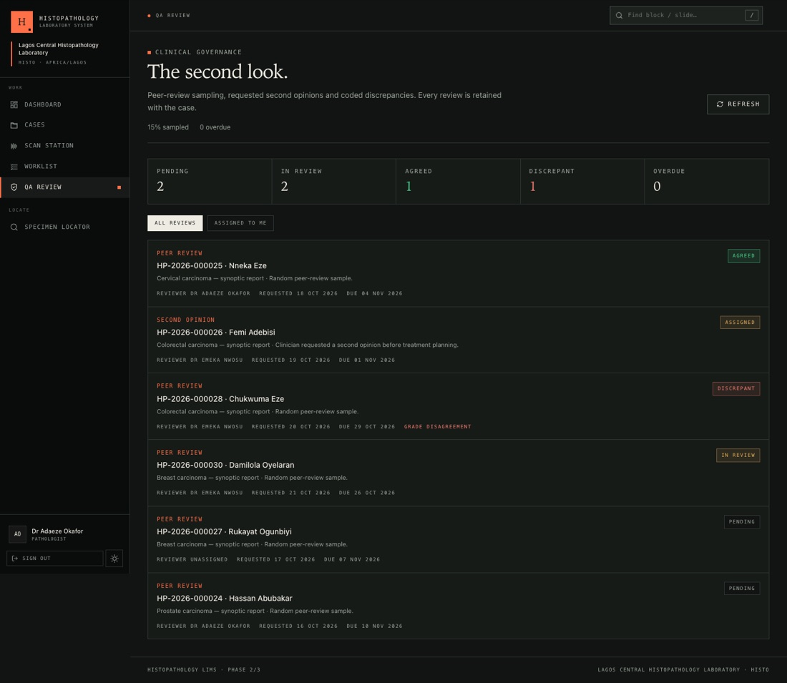                                  |
| **Billing & HMO claims**                                 | **Clinical coding**                                                |
| 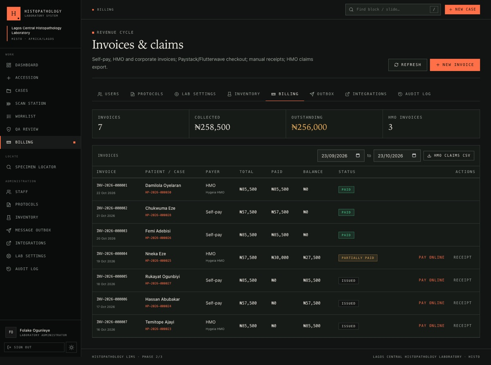                     | 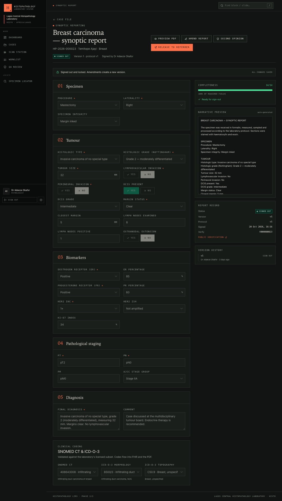       |

---

## What Phase 1 delivers

| Requirement                                          | Implementation                                                                                                                                                                           |
| ---------------------------------------------------- | ---------------------------------------------------------------------------------------------------------------------------------------------------------------------------------------- |
| Auth, JWT access + refresh, role guards, lab tenancy | Rotating refresh tokens, bcrypt passwords, role + capability guards, tenant context enforced by a Mongoose plugin                                                                        |
| Accessioning                                         | Atomic patient + case + specimen creation, configurable accession format (`HP-2026-000123`), auto-MRN, priorities and TAT windows                                                        |
| Barcodes and labels                                  | Unique Data Matrix/QR payloads, 50 × 25 mm print-ready PDF, ZPL output, SVG preview                                                                                                      |
| Custody tracking                                     | Seven scan stations, keyboard-wedge first, instant visual + audible feedback, invalid transitions rejected with the allowed next states                                                  |
| Specimen locator                                     | Any specimen/block/slide barcode → current station, hierarchy and full append-only timeline                                                                                              |
| Grossing and microtomy                               | Gross descriptions, block creation, slide cutting, special-stain requests, recut requests, specimen rejection                                                                            |
| Pathologist worklist                                 | Frozen → urgent → routine, then TAT deadline; filters and live countdowns; warning at 80% of the window                                                                                  |
| Synoptic reporting                                   | Four seeded cancer protocols (breast, colorectal, prostate, cervix), dynamic required-field validation, auto-generated narrative, version history, lock on sign-out, reasoned amendments |
| PDF report                                           | Lab letterhead, synoptic narrative, signature block, QR verification, Unicode fonts, page numbering, draft watermark                                                                     |
| Dashboard                                            | Cases by status and priority, TAT by stage, overdue breach watch, pathologist workload, recent accessions                                                                                |
| Audit                                                | Every create, update, scan, sign-out and amendment with actor, before/after values, IP/user agent and request ID                                                                         |
| Offline resilience                                   | Installable PWA, cached app shell, offline screen, IndexedDB scan queue, idempotent batch replay and on-device queue badge                                                               |
| Quality                                              | Strict TypeScript, Zod contracts shared by both apps, class-validator DTOs, Swagger, unit + E2E tests, ESLint and Prettier                                                               |

## What Phase 2 and Phase 3 add

| Requirement                  | Implementation                                                                                                                                                                      |
| ---------------------------- | ----------------------------------------------------------------------------------------------------------------------------------------------------------------------------------- |
| Referrer portal              | Magic-link + six-digit OTP sign-in, one-time hashed tokens, rate-limited requests, case status, released-report view and PDF download                                               |
| SMS / WhatsApp / email       | Notification outbox with delivery state and retries; SMTP, Termii, Twilio SMS and Twilio WhatsApp adapters; safe log/outbox mode for local development                              |
| Report release               | Explicit pathologist/admin release after sign-out, referrer notification, release audit; amendment resets release until re-released                                                 |
| Reagent & antibody inventory | Lot-level quarantine/validation, expiry alerts, stock adjustment, usage tracking and a usable-lot check before any stain run                                                        |
| Stain runs                   | Link slide/block to multiple lots, consume stock atomically, QC pass advances the slide to `STAINED`; expired or unvalidated lots are blocked with a clear reason                   |
| QA peer review               | Sampled peer review at sign-out, requested second opinions, coded discrepancies, severity, action plans, reviewer queue and QA statistics                                           |
| Rejection codes              | Coded specimen rejection (mislabelled, fixation delay, insufficient tissue, contamination, broken slide, lost in processing, unrepresentative, other) retained in the custody event |
| Offline sync                 | IndexedDB mutation queue for scan stations, automatic replay on reconnect, idempotency keys and a batch `/sync` API that returns per-mutation results                               |
| FHIR R4                      | `Patient`, `ServiceRequest`, `Specimen` and `DiagnosticReport` read/search resources, CapabilityStatement, SNOMED/ICD-O-3 coding and PDF links                                      |
| HL7 v2                       | MLLP listener for ORM^O01 / OML^O21 order intake, ACK AA/AE, and ORU^R01 result rendering from signed reports                                                                       |
| Whole-slide imaging          | Link image/viewer URLs to a slide, scanner webhook signed with HMAC-SHA256, barcode lookup, and WSI actions in the case file                                                        |
| SNOMED CT / ICD-O-3          | Laboratory-licensed code subset import, terminology search, report coding validation, PDF coding block and FHIR coding output                                                       |
| Payments                     | Invoices for self-pay, HMO and corporate payers; Paystack/Flutterwave checkout; webhook verification; cash/transfer receipts; local mock checkout                                   |
| HMO claims                   | Claim-ready invoice fields, authorization numbers and CSV export                                                                                                                    |
| Notifications visibility     | Admin outbox with channel, provider, recipient, status, errors and retry                                                                                                            |

## Architecture

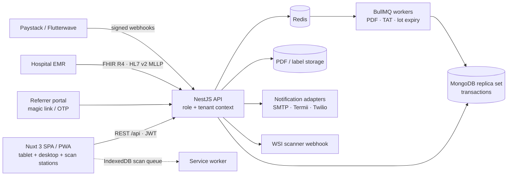

**Monorepo**

```
apps/
  api/        NestJS: auth, labs, users, patients, cases, specimens,
              blocks, slides, custody, worklist, reports, protocols,
              labels, dashboard, audit, pdf, jobs
  web/        Nuxt 3: app shell, accessioning, scan station, worklist,
              locator, synoptic editor, referral portal, QA, inventory,
              billing, integrations, verification, offline queue
packages/
  shared/     Domain vocabulary, state machines, Zod schemas, API types,
              TAT + accession formatting, protocol validation/narrative,
              Phase 2/3 contracts
docker/       Mongo replica-set initialiser
docs/         Architecture notes and screenshots
```

See [docs/architecture.md](docs/architecture.md) for the Phase 1 core and [docs/phase-2-3.md](docs/phase-2-3.md) for referral, inventory, QA, offline sync, interoperability and billing design.

### Domain hierarchy

```
Patient → Case (accession) → Specimen → Block (cassette) → Slide
```

Every physical action is a `custody_events` document:

```
entityType · entityId · eventType · station · fromState → toState
user · timestamp · labId · metadata
```

Custody events, audit logs and signed report versions are **append-only** at the Mongoose layer — update and delete middleware throws.

### Physical state machine

```
ACCESSIONED → GROSSED → PROCESSING → EMBEDDED → CUT → STAINED
            → WITH_PATHOLOGIST → REPORTED → ARCHIVED

CUT / STAINED / WITH_PATHOLOGIST → RECUT_REQUESTED → CUT → STAINED
Any pre-archive state → REJECTED  (slides may recover into STAINED)
```

Case states are separate:

```
RECEIVED → IN_PROGRESS → PENDING_REVIEW → REPORTED → AMENDED
```

Stations infer the next event from the scanned entity and its current state. The API returns `409` with the legal next states when a scanner fires out of order.

### Multi-tenancy

`labId` is added to every tenant collection by a Mongoose plugin and injected into **every** read, write and aggregation from a verified JWT. There is no `labId` request parameter to forget or tamper with. Cross-tenant ids resolve as `404`. The only bypass is an explicitly scoped system context used for public report verification and the seed script.

### Transactions

Accessioning, grossing, slide cutting, scans, report sign-out and amendments run in MongoDB transactions. That is why Docker Compose runs Mongo as a replica set. A scan updates the entity projection, appends the custody event, advances the case and writes the audit entry together.

## Quick start — Docker

Prerequisites: Docker with Compose v2.

```bash
# Optional: local overrides for secrets and ports
cp .env.example .env

docker compose up -d --build
docker compose --profile tools run --rm seed
```

- Web: <http://localhost:3000>
- API: <http://localhost:4000/api>
- Swagger: <http://localhost:4000/docs>
- Health: <http://localhost:4000/api/health>

The `seed` profile is a one-shot container. It drops and rebuilds the sample dataset when `SEED_RESET=true`, which is the default for that command. Use `docker compose down -v` to remove Mongo/Redis/PDF volumes entirely.

**Referral portal demo:** open `/portal/login`, use lab code `HISTO` and `referrer@clinic.ng`. The local Compose stack sets `PORTAL_DEBUG=true`, so the one-time code is shown on screen and written to the outbox. Set it to `false` in any shared environment. `HP-2026-000025` has a released report; `HP-2026-000023` is signed but unreleased and is useful for demonstrating the release action.

**Phase 2/3 demo surfaces:** `/admin/inventory` (lots and stain runs), `/qa` (peer review and discrepancy), `/admin/billing` (invoices, mock checkout, claims CSV), `/admin/notifications` (outbox), `/admin/integrations` (FHIR/HL7/WSI/terminology map), and `/payments/mock?reference=…` (local checkout).

Docker services use local development defaults. Set real secrets in `.env` or your orchestrator for any shared environment, and run the API with `NODE_ENV=production` there. Environment validation rejects development secrets in production.

## Quick start — local development

Prerequisites: Node.js 22.12+, pnpm 12+, Docker (for Mongo/Redis).

```bash
cp .env.example .env
docker compose up -d mongo mongo-init redis

pnpm install
pnpm seed:reset
pnpm dev
```

`pnpm dev` builds the shared package, then runs the shared watcher, API (`:4000`) and Nuxt (`:3000`) together.

If Redis is not available, set `QUEUES_ENABLED=false`. PDF generation and notification stubs then run inline; custody and reporting remain fully functional.

### Demo accounts

All seeded users share one lab, **HISTO**. Passwords are shown for local demonstration only.

| Role                        | Email                   | Password            |
| --------------------------- | ----------------------- | ------------------- |
| Super administrator         | `superadmin@histo.ng`   | `SuperAdmin#2026`   |
| Lab administrator           | `admin@histo.ng`        | `LabAdmin#2026`     |
| Receptionist                | `reception@histo.ng`    | `Reception#2026`    |
| Grossing officer            | `grosser@histo.ng`      | `Grosser#2026`      |
| Medical lab scientist       | `technologist@histo.ng` | `Technologist#2026` |
| Pathologist (breast/GI)     | `pathologist@histo.ng`  | `Pathologist#2026`  |
| Pathologist (urology/gynae) | `pathologist2@histo.ng` | `Pathologist#2026`  |
| Referring clinician         | `referrer@clinic.ng`    | `Referrer#2026`     |

The seed creates 30 realistic cases across received, grossed, processing, embedded, cut/stained, pending review, reported, amended and archived stages, plus reagent/stain-run data, QA reviews, WSI links, terminology, invoices, payments and a released referral portal history. Try scanning `BL-HP-2026-000004-A1` at the grossing station, or use the specimen locator with that barcode. The referring clinician signs in at `/portal/login` with `referrer@clinic.ng`; the password account remains available for staff-side administration only.

## Environment variables

| Variable                             | Default                                                                     | Purpose                                       |
| ------------------------------------ | --------------------------------------------------------------------------- | --------------------------------------------- |
| `NODE_ENV`                           | `development`                                                               | `production` rejects development JWT secrets  |
| `API_PORT` / `API_PREFIX`            | `4000` / `api`                                                              | API listener and global route prefix          |
| `CORS_ORIGINS`                       | `http://localhost:3000`                                                     | Comma-separated allowed browser origins       |
| `PUBLIC_WEB_URL` / `PUBLIC_API_URL`  | localhost                                                                   | Used in PDF verification links and docs       |
| `MONGODB_URI`                        | `mongodb://localhost:27017/histo_lims?replicaSet=rs0&directConnection=true` | Must point at a replica set                   |
| `REDIS_URL`                          | `redis://localhost:6379`                                                    | BullMQ connection                             |
| `QUEUES_ENABLED`                     | `true`                                                                      | `false` runs PDF/notifications inline         |
| `JWT_ACCESS_SECRET`                  | — (required, 32+ chars)                                                     | Access-token signing key                      |
| `JWT_REFRESH_SECRET`                 | — (required, 32+ chars)                                                     | Refresh-token signing key                     |
| `JWT_ACCESS_TTL` / `JWT_REFRESH_TTL` | `15m` / `7d`                                                                | Token lifetimes (`s`, `m`, `h`, `d`)          |
| `STORAGE_DIR`                        | `./storage`                                                                 | Generated report PDFs; mount a durable volume |
| `SWAGGER_ENABLED`                    | `true`                                                                      | Serve OpenAPI docs at `/docs`                 |
| `LOG_LEVEL`                          | `info`                                                                      | Pino level                                    |
| `NUXT_PUBLIC_API_BASE`               | `http://localhost:4000/api`                                                 | Browser-facing API base                       |
| `NUXT_PUBLIC_WEB_BASE`               | `http://localhost:3000`                                                     | Browser-facing web base                       |
| `NUXT_PUBLIC_APP_NAME`               | `Histopathology LIMS`                                                       | Shell label                                   |
| `SEED_RESET`                         | `false`                                                                     | Allow the seed script to drop the database    |

The API validates the environment with Zod at startup and fails fast on missing or unsafe values. In local development both apps read the repository-root `.env`; in Docker, Compose injects the values.

## Scripts

| Command                               | What it does                                                                                                   |
| ------------------------------------- | -------------------------------------------------------------------------------------------------------------- |
| `pnpm dev`                            | Shared watcher + API + web                                                                                     |
| `pnpm build`                          | Build shared, API and web                                                                                      |
| `pnpm typecheck`                      | Strict TypeScript across all workspaces                                                                        |
| `pnpm lint` / `pnpm format:check`     | ESLint / Prettier checks                                                                                       |
| `pnpm test:unit`                      | Custody state machine and report sign-out policy tests                                                         |
| `pnpm test:e2e`                       | MongoDB replica-set E2E: accession → blocks → scans → slides → report → PDF → amendment, plus tenant isolation |
| `pnpm verify`                         | Lint + typecheck + unit + E2E + full build                                                                     |
| `pnpm seed` / `pnpm seed:reset`       | Seed only if empty / drop and reseed                                                                           |
| `pnpm db:up` / `pnpm db:down`         | Local Mongo replica set + Redis                                                                                |
| `pnpm docker:up` / `pnpm docker:seed` | Compose stack / one-shot seed                                                                                  |

### API surface (abridged)

```
POST   /api/auth/login | /refresh | /logout        GET /api/auth/me
POST   /api/cases/accession                        GET /api/cases[/:id]
PATCH  /api/cases/:id | /:id/assign
POST   /api/blocks/gross                           POST /api/slides/cut
POST   /api/slides/request | /:id/recut            POST /api/specimens/:id/reject
POST   /api/custody/scan                           GET  /api/custody/locator/:barcode
GET    /api/custody/case/:caseId/timeline
GET    /api/worklist                               POST /api/worklist/:caseId/claim
GET    /api/reports/case/:caseId                   POST /api/reports/case/:caseId
PATCH  /api/reports/:id                            POST /api/reports/:id/sign-out | /amend
GET    /api/reports/:id/pdf                        GET  /api/reports/verify/:code  (public)
GET    /api/labels/:entityType/:id?format=pdf|zpl|svg&symbology=datamatrix|qr
GET    /api/labels/case/:caseId?include=all|specimens|blocks|slides
GET    /api/dashboard                              GET  /api/protocols
GET    /api/users[/pathologists]                   GET  /api/labs/me
GET    /api/audit                                  POST /api/maintenance/tat-check
GET    /api/health  (public)                       Swagger at /docs

Phase 2/3 additions:
POST   /api/portal/auth/request | /verify          GET /api/portal/cases[/:id]
GET    /api/portal/cases/:id/report.pdf            POST /api/reports/:id/release
GET    /api/inventory/lots                         POST /api/inventory/lots
POST   /api/inventory/lots/:id/validate|reject|adjust
GET    /api/inventory/stain-runs                   POST /api/inventory/stain-runs
POST   /api/inventory/stain-runs/:id/complete      POST /api/inventory/expiry-check
GET    /api/qa/reviews | /stats                    POST /api/qa/reviews
POST   /api/qa/reviews/:id/assign|start|complete
POST   /api/sync/batch                             (Idempotency-Key supported on /custody/scan)
GET    /api/fhir/r4/metadata                       GET /api/fhir/r4/Patient|ServiceRequest|Specimen|DiagnosticReport
POST   /api/interop/hl7/messages                   GET /api/interop/hl7/oru/:caseId
POST   /api/wsi/slides/:id/link                    GET /api/wsi/:barcode  POST /api/wsi/webhook
GET    /api/terminology/search                     POST /api/terminology/import
POST   /api/invoices                               GET /api/invoices
POST   /api/invoices/:id/payments/initialize|manual
POST   /api/payments/webhooks/paystack|flutterwave  GET /api/payments/:reference
GET    /api/claims/export                          GET /api/notifications/outbox
```

All endpoints are documented in Swagger with bearer auth, DTOs and error shapes.

## Testing

```bash
pnpm test:unit
pnpm test:e2e
pnpm verify
```

The E2E suite (16 tests) starts an ephemeral MongoDB **replica set** with `mongodb-memory-server`, seeds a second tenant, and proves:

- accessioning generates a formatted accession number and unique specimen barcode
- role checks and invalid scan transitions reject correctly
- a block moves through grossing → processing → embedding → cutting → staining → pathologist
- a complete synoptic report signs out, locks, marks slides/blocks reported and advances the case
- public verification and server-side PDF/label endpoints work
- an amendment creates version 2 and moves the case to `AMENDED`
- a user from another lab gets `404` / an empty list — tenant isolation
- audit log contains scan, sign-out and amendment entries
- a released report is visible in the referral portal after magic-link verification
- expired or unvalidated reagent lots are rejected before a stain run consumes stock
- peer review records a coded discrepancy
- FHIR R4, WSI linking and HL7 order ingestion respond correctly
- a mock Paystack checkout settles the invoice and appears in the HMO CSV
- an offline scan mutation replays idempotently

## Design direction

The visual system is clinical but opinionated: bone and ink surfaces, a single vermilion accent, a serif display face for hierarchy and monospaced metadata for barcodes and statuses. No decorative gradients, no stock dashboard charts. Status chips are readable at a glance in light and dark mode. The scan station deliberately abandons the app shell: full-screen, large type, keyboard-first, green/red feedback and audible confirmation.

Tokens live in [`apps/web/tailwind.config.ts`](apps/web/tailwind.config.ts) and semantic CSS variables in [`apps/web/assets/css/main.css`](apps/web/assets/css/main.css). The app is responsive from 390 px mobile through 1024 px tablet to wide desktop, with accessible labels, focus states and reduced-motion support.

## Security and operations notes

- Access tokens and refresh tokens are held in first-party cookies for the SPA. For a multi-user hospital deployment, proxy the API behind HTTPS and consider moving the refresh token to an `HttpOnly`, `Secure` cookie. Refresh tokens are hashed and rotated server-side.
- The tenant plugin fails closed without request context. Public verification and seeding use an explicit system context.
- Helmet, compression, request IDs, Pino redaction, bcrypt and strict DTO whitelisting are enabled. Rate limiting should be added at the reverse proxy or an API gateway before internet exposure.
- PDFs are written to `STORAGE_DIR`; use an encrypted persistent volume with retention/backup policy. Reports are clinical records — never mount ephemeral container storage in production.
- MongoDB runs without auth in the supplied Compose file for local development only. Use authentication, TLS, a three-member replica set, backups and least-privilege users in production.
- An audit entry is written for each mutation; the audit and custody collections are append-only at the data layer.
- Patient data protection: tune log retention, access reviews and NDPR/NDPA obligations for your jurisdiction. The seed contains fictitious patients only.
- `PORTAL_DEBUG`, `PAYMENTS_MODE=mock` and `NOTIFICATIONS_MODE=outbox` are local-development conveniences. Disable them in production.
- MLLP is plain TCP; place it on a restricted clinical VLAN or behind a TLS/allowlist proxy.
- Payment webhooks are signature-verified; never trust a client redirect as proof of payment.
- Terminology content is licensed separately. The seed subset is for demonstration only.

## Phase 4 / hardening

The Phase 2/3 feature set is implemented. The next engineering pass is operational hardening, not a hidden backlog:

- move refresh tokens to `HttpOnly` cookies behind a same-site reverse proxy and add gateway rate limiting
- replace local PDF storage with encrypted object storage and retention policies
- run the HL7 MLLP listener behind a network allowlist/TLS terminator and add message replay monitoring
- connect production SMTP/Termii/Twilio/Paystack/Flutterwave credentials and contract tests against provider sandboxes
- load a licensed, maintained SNOMED CT / ICD-O-3 release and define a terminology update process
- extend the offline queue beyond scans to grossing/stain-run drafts with conflict-resolution UI
- add a full data-processing agreement, backup drills and NDPR/NDPA access reviews

## Conventional commits

This repository follows conventional commits (`feat(api):`, `fix(web):`, `test:`, `chore:`, `docs:`). Examples:

```
feat(api): enforce custody transitions in scan transactions
feat(web): add keyboard-first grossing scan station
test(api): cover sign-out lock and amendment versioning
docs: add local and Docker setup
```

## License

Proprietary / unlicensed. All rights reserved.
